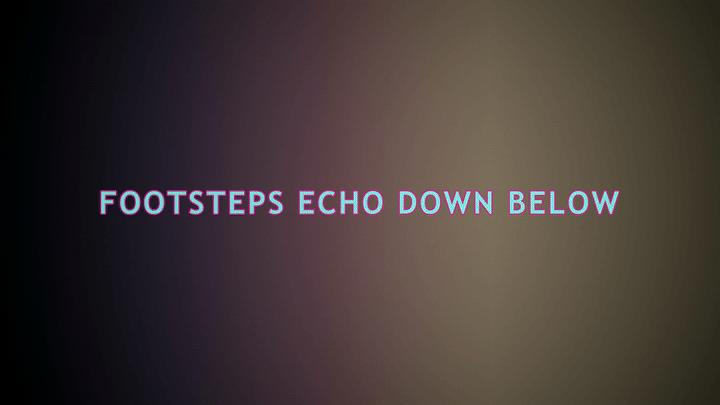
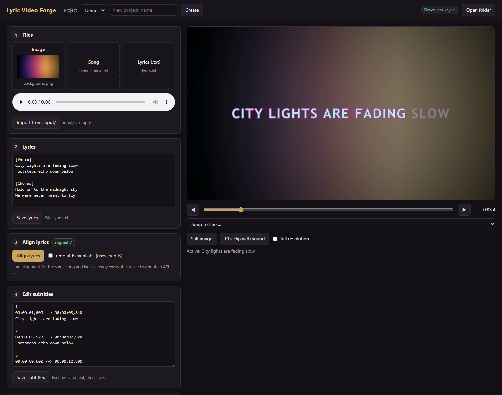
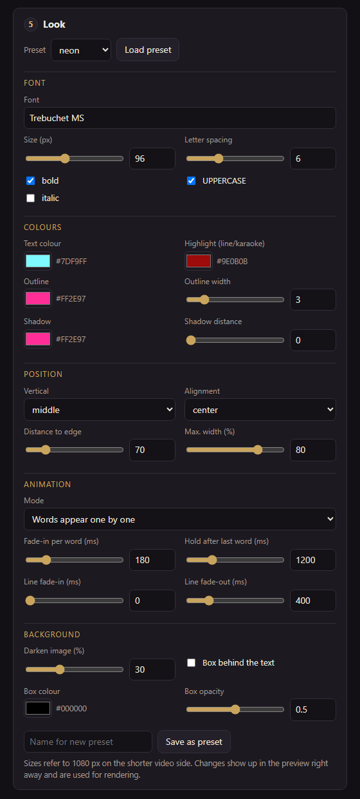
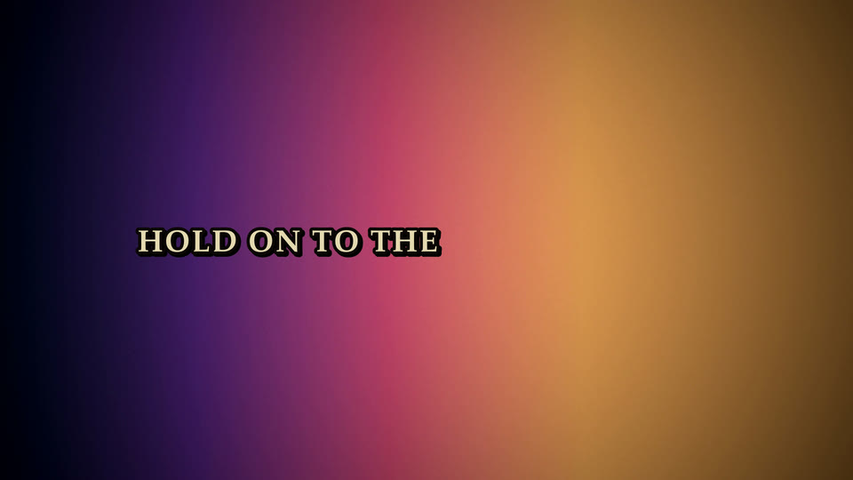
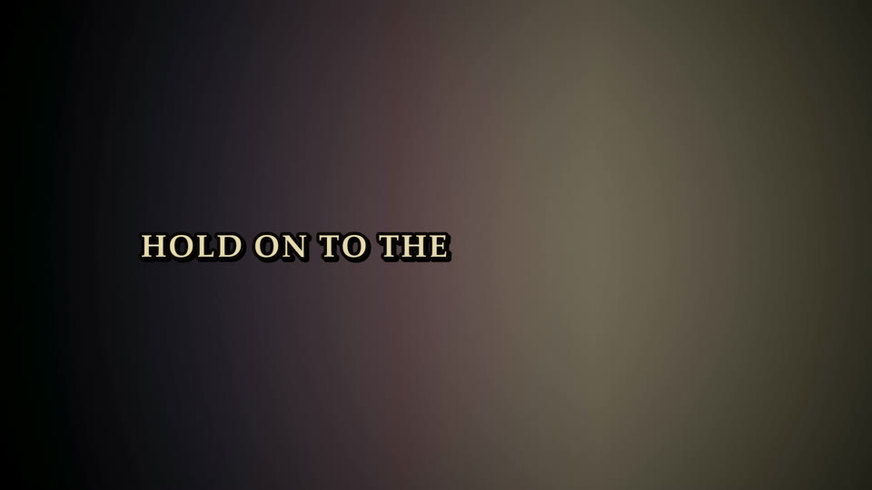
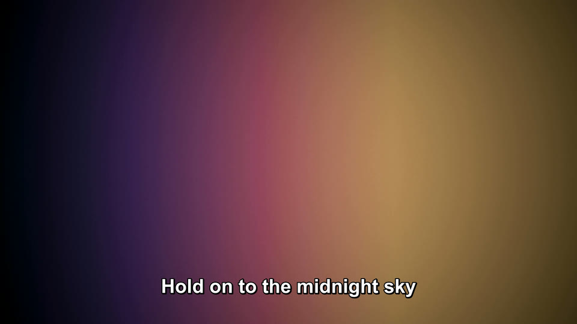
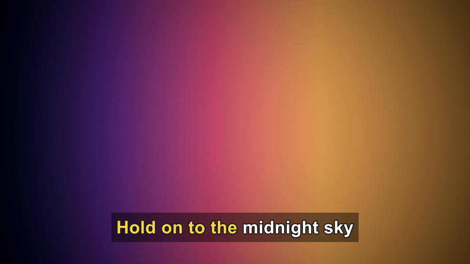
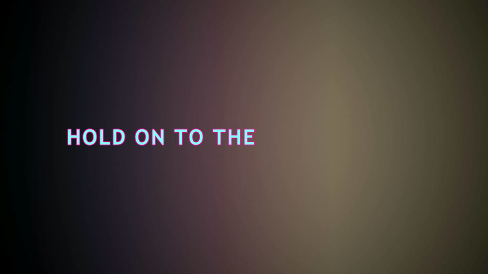
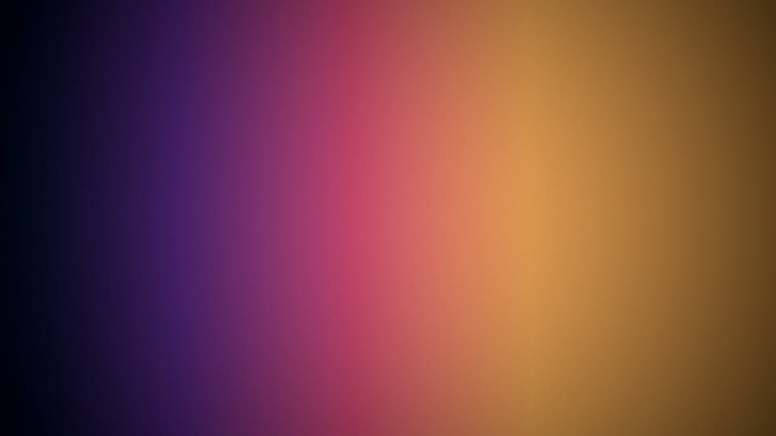

# Lyric Video Forge

**Turn a still image, a song and the lyrics you already have into a finished lyric video – with word-accurate timing.**

Lyric Video Forge does not try to *recognise* the lyrics. You provide the exact text, and the
[ElevenLabs Forced Alignment API](https://elevenlabs.io/docs/api-reference/forced-alignment) tells it
*when* each word is sung. The result is an editable SRT file plus an MP4 with styled, burned-in subtitles –
words can appear one by one, light up karaoke-style, or show as whole lines.

<p align="center">
  
  <br><em>"neon" preset with <code>highlight: reveal</code> – every word fades in the moment it is sung.</em>
</p>

Everything runs locally: a small Python script, `ffmpeg` for rendering, and an optional browser UI.
The only thing that leaves your computer is the alignment request to ElevenLabs (audio + lyrics), and
even that can be replaced by a fully offline backend.

---

## Contents

- [Features](#features)
- [How it works](#how-it-works)
- [What does it cost? (ElevenLabs credits)](#what-does-it-cost-elevenlabs-credits)
- [Installation](#installation)
- [Quick start: web UI](#quick-start-web-ui)
- [Quick start: terminal](#quick-start-terminal)
- [The lyrics file](#the-lyrics-file)
- [Styles and presets](#styles-and-presets)
- [Commands and options](#commands-and-options)
- [config.json](#configjson)
- [Alignment details](#alignment-details)
- [Optional: offline alignment](#optional-offline-alignment)
- [Troubleshooting](#troubleshooting)
- [Tests](#tests)
- [Project layout](#project-layout)

---

## Features

- **Word-accurate timing from your own lyrics** – no speech recognition errors, because the text is given.
- **Four animation modes:** words appear one by one (`reveal`), karaoke colouring (`karaoke`),
  whole line in a highlight colour (`line`) or plain lines (`none`).
- **Fully styleable subtitles:** font, size, colours, outline, shadow, box behind the text, position,
  alignment, letter spacing, fades, darkening of the background image – stored as reusable presets.
- **Browser UI** with drag & drop, live preview, sliders and colour pickers, 10-second clips with sound,
  render progress bar and an in-page video player.
- **Editable SRT** as the single source of truth – fix a timestamp or a typo and render again.
- **Credit-saving cache:** the API response is stored; re-cutting your lines or re-rendering never calls the API again.
- **Quality report** after alignment: suspiciously short/long lines, poor matches, and long gaps where
  lyrics might be missing (common with AI-generated songs).
- **Trim & fade-out:** end the video at any point with a smooth picture and audio fade.
- **Any aspect ratio:** 16:9, 9:16 (Shorts/Reels/TikTok) or square – styles scale automatically.
- **Optional offline mode** with Whisper (stable-ts) and vocal separation with demucs.

## How it works

```
 lyrics.txt ─┐
             ├─► ElevenLabs forced alignment ─► word timings (.alignment.json, cached)
 song.mp3 ───┘                                        │
                                                      ▼
                                       editable subtitles (.srt)  ◄── you fix times/text here
                                                      │
 image.png ──────────────► ffmpeg + libass ◄── style preset (styles.json)
                                 │
                                 ▼
                          lyric video (.mp4)
```

1. **Align** – the lyrics (only the sung lines) and the audio are sent to ElevenLabs. The response
   contains a start and end time for every word and is saved immediately.
2. **Edit** – the words are mapped back to your lines and written as an SRT file. Check it, fix what
   you like.
3. **Style & preview** – choose a preset, tweak it, look at stills or short clips.
4. **Render** – the image is fitted to the video size, the subtitles are generated as an `.ass` file with
   your style and burned in with ffmpeg. The original audio file is used unchanged.

## What does it cost? (ElevenLabs credits)

You need an ElevenLabs account and an API key, but **the free plan is enough for most people**:

- The **free plan includes 10,000 credits** (at the time of writing).
- Aligning a **typical 3–4 minute song uses roughly 100 credits**.
- That is on the order of **100 songs on the free plan**.

On top of that, every alignment is cached. Re-rendering, changing styles, editing the SRT or even
re-cutting the line breaks of your lyrics does **not** use credits again. Only a new audio file or
changed words trigger a new API call – and the tool asks before it does so.

Prefer to stay fully offline? Use the [local backend](#optional-offline-alignment) – no account, no credits.

> Credit amounts and plan details can change – check your ElevenLabs dashboard for the current numbers.

## Installation

Requirements:

- **Python 3.10+**
- **ffmpeg with libass** in your `PATH` (most full builds include it)
- An **ElevenLabs API key** with the permission *Speech to Text* (not needed for the offline backend)

The tool is developed and tested on **Windows**. It also runs on Linux/macOS; there, put the fonts you
want to use into the `fonts/` folder (system fonts are only detected automatically on Windows).

### Windows

```bash
winget install Python.Python.3.12
winget install Gyan.FFmpeg
```

Reopen the terminal, then in the project folder:

```bash
python -m venv venv
venv\Scripts\python -m pip install -r requirements.txt
```

### Linux / macOS

```bash
sudo apt install python3 python3-venv ffmpeg   # or: brew install python ffmpeg
python3 -m venv venv
venv/bin/python -m pip install -r requirements.txt
```

You can always start the tool with plain `python lyricvideo.py …` – it automatically restarts itself
with the Python from `venv/`.

### API key

1. In ElevenLabs open **Developers → API Keys**, create a key and allow **Speech to Text**.
2. Copy `.env.example` to `.env` and paste the key:

```
ELEVENLABS_API_KEY=your-key-here
```

`.env` is listed in `.gitignore` and is never printed or uploaded anywhere except to ElevenLabs.
Alternatively you can set the environment variable `ELEVENLABS_API_KEY`.

## Quick start: web UI

The easiest way. On Windows double-click **`Lyricvideo-Web.bat`**, or run:

```bash
python lyricvideo.py web
```

Your browser opens `http://127.0.0.1:8765`. The server only listens on your own computer. Keep the
terminal window open while you work (stop with Ctrl+C).

<p align="center">
  
</p>

1. **Project** – choose one at the top or type a name and click *Create*.
2. **Files** – drop an image, a song and a lyrics `.txt` onto the three boxes (or click them).
   *Import from input/* takes the files from the `input/` folder instead.
3. **Lyrics** – fix the text directly in the box if needed and save.
4. **Align lyrics** – calls ElevenLabs (or reuses a stored alignment for free).
5. **Edit subtitles** – correct times and text in the SRT and save.
6. **Look** – choose a preset and adjust everything with sliders, colour pickers and drop-downs.
   The preview on the right updates instantly. Jump around with the time slider, the arrows or the
   line list; *10 s clip with sound* shows the animation. *Save as preset* stores your values in `styles.json`.
7. **Render video** – with progress bar; the finished video plays right on the page.
8. **Trim** – play the video, pause where it should end, click *End = video position* (or type a time
   like `3:40`) and render again. Picture and sound fade out before the end (default 2 s).

<p align="center">
  
</p>

The style values you set in the browser are remembered per project and are also used when you
render that project from the terminal later (unless you pass `--style`).

## Quick start: terminal

1. Put **one image** (`.png/.jpg/.webp/.bmp`), **one audio file** (`.mp3/.wav/.flac/.m4a/.aac/.ogg/.opus/.wma`)
   and **the lyrics as `.txt`** into `input/`. File names do not matter. If there are several files of
   the same type, the script asks which one to use.
2. Run:

```bash
python lyricvideo.py
```

3. Enter a project name (Enter takes the name of the audio file). Everything ends up in `output/<project>/`.

What happens (same as `python lyricvideo.py all`):

1. **align** – creates `<project>.srt` and `<project>.alignment.json` and prints a quality report.
2. Pause: *"Check and edit the SRT now, then press Enter."*
3. Optional preview loop: `[i]` preview image, `[c]` clip with sound, `[s]` switch style,
   `[r]` render, `[q]` quit. `styles.json` is re-read for every preview, so you can edit it in between.
4. **render** – writes `<project>.mp4` (and `<project>.ass`).

Options can be appended directly, e.g. `python lyricvideo.py --project "Midnight Drive" --style neon`.

### What ends up in the project folder

```
output/Midnight Drive/
   Midnight Drive.mp4              the finished video
   Midnight Drive.srt              lyrics and timings – this is the file you edit
   Midnight Drive.alignment.json   stored API response (word timings)
   Midnight Drive.ass              generated styled subtitles (rebuilt on every render)
   preview.png / preview.mp4       latest preview
   project.json                    remembers source files, style and trim settings
   source/                         copies of image, audio and lyrics
```

Because the input files are copied to `source/`, you can re-render a project at any time, even when
`input/` already holds the next song.

## The lyrics file

UTF-8 text, **one sung line per line**. Every line becomes exactly one subtitle.

```
[Verse]
City lights are fading slow
Footsteps echo down below

[Chorus]
Hold on to the midnight sky
We were never meant to fly
```

- Empty lines and section labels in square brackets like `[Chorus]` are ignored and not sent to the API.
- Repeated choruses must appear as often as they are sung.
- Any language and script works (accents, umlauts, apostrophes, hyphens …).
- See [`examples/lyrics-example.txt`](examples/lyrics-example.txt).

## Styles and presets

Presets live in `styles.json`. Five are included:

| `standard` | `grimdark` |
|---|---|
|  |  |
| **`clean`** | **`karaoke`** |
|  |  |
| **`neon`** | *background used for all examples* |
|  |  |

*All examples show the same moment (11.5 s) of the demo track. `standard`, `grimdark` and `neon` use
`reveal`, so only the words sung so far are visible; `karaoke` colours the words already sung.*

### All style fields

Every field is optional. Missing values come from the preset `standard`, then from built-in defaults.
**Pixel values** (`size`, `outline_width`, `shadow_depth`, `margin`, `letter_spacing`) refer to
**1080 px on the shorter video side**, so the same style looks the same in 1920×1080 and 1080×1920.

| Field | Meaning | Example values |
|---|---|---|
| `font` | font name as shown in Windows, or a font from `fonts/` | `"Arial"`, `"Palatino Linotype"` |
| `bold` / `italic` | bold / italic | `true`, `false` |
| `size` | font size in px | `64`, `92` |
| `color` | text colour (hex) | `"#FFFFFF"`, `"#F5E6C8"` |
| `outline_color` | outline colour | `"#000000"` |
| `outline_width` | outline width in px (0 = none) | `4`, `7` |
| `shadow_color` | shadow colour | `"#000000"` |
| `shadow_depth` | shadow distance in px (0 = none) | `2`, `5` |
| `box` | semi-transparent box behind the text | `true`, `false` |
| `box_color` | box colour | `"#000000"` |
| `box_opacity` | box opacity, 0 to 1 | `0.5` |
| `position` | `bottom`, `middle` or `top` | `"bottom"` |
| `margin` | distance to the edge in px | `70` |
| `align` | `left`, `center` or `right` | `"center"` |
| `uppercase` | everything in capitals | `true` |
| `letter_spacing` | letter spacing in px | `0`, `4` |
| `max_width_percent` | maximum text width in % of the video width; longer lines wrap | `85` |
| `fade_in_ms` / `fade_out_ms` | fade per line in ms | `150`, `400` |
| `hold_ms` | keep a line this many ms after its last word, at most until the next line starts. The fade-out happens during this time, so the last word stays readable. The SRT is not changed | `600`, `1500` |
| `highlight` | `none`, `line`, `karaoke` or `reveal` (see below) | `"reveal"` |
| `highlight_color` | colour for `line` / `karaoke` | `"#FFD700"` |
| `word_fade_ms` | for `reveal`: fade-in time per word in ms (0 = instant) | `120`, `150` |
| `background` | darken the image so the text stays readable | `{"dim_percent": 35}` |

**Animation modes (`highlight`):**

- `none` – the whole line in `color`.
- `line` – the whole line in `highlight_color`.
- `karaoke` – the line appears in `color`, every word turns `highlight_color` while it is sung.
- `reveal` – **words appear one by one** exactly when they are sung (fade length `word_fade_ms`).
  The line is laid out completely from the start, so words never jump when new ones appear.
  Tip: `fade_in_ms: 0` works well with `reveal`; `fade_out_ms` fades the whole line at the end.

`karaoke` and `reveal` use the word timings from the `.alignment.json`. If you move a whole line in the
SRT, the word timings move with it. If you change the text of a line so it no longer matches, that line
falls back to `line`/`none` and you get a notice.

Colours are written as normal `#RRGGBB`; the conversion to the ASS format (blue-green-red) is done for you.

### Tuning a style in the terminal

```bash
python lyricvideo.py preview --project "Midnight Drive" --style neon --time 30
```

Below the preview the tool prints every value it used and, in `[brackets]`, where the value came from
(`neon`, `standard`, `command line`, `built-in`). Try values without touching `styles.json`:

```bash
python lyricvideo.py preview -p "Midnight Drive" --size 80 --color "#FFD700" --position top --box --dim-percent 40
```

Yes/no fields: `--box`/`--no-box`, `--uppercase`/`--no-uppercase`, `--bold`/`--no-bold`, `--italic`/`--no-italic`.
Add `--clip 10` to see fades and word animation in motion. When you like it, copy the values into a
preset in `styles.json` (or use *Save as preset* in the web UI).

### Custom fonts

Put `.ttf`/`.otf` files into `fonts/` and use the font's family name in `font`, e.g. `"Cinzel"` or
`"Bebas Neue"` (both free on Google Fonts). ffmpeg gets this folder via `fontsdir`. If a font is found
neither in the system nor in `fonts/`, you get a clear warning and Arial is used.

## Commands and options

```bash
python lyricvideo.py                                      # everything in one go (same as "all")
python lyricvideo.py align   --project "Midnight Drive"
python lyricvideo.py preview --project "Midnight Drive" --time 30
python lyricvideo.py preview --project "Midnight Drive" --time 1:05 --clip 10
python lyricvideo.py render  --project "Midnight Drive"
python lyricvideo.py render  --project "Midnight Drive" --end 3:40 --fade-out 2
python lyricvideo.py web                                  # browser UI
python lyricvideo.py projects                             # list projects
python lyricvideo.py styles                               # list style presets
```

If you leave out the project name for `preview`/`render`, the tool shows a numbered list of projects
(most recently edited first).

| Option | Meaning |
|---|---|
| `--project NAME`, `-p NAME` | project name = folder `output/NAME/` |
| `--style NAME` | preset from `styles.json` (default: `default_style` in `config.json`) |
| `--backend elevenlabs\|local` | alignment via the API (default) or offline |
| `--language CODE` | language, e.g. `en`, `de`, `es` – **only used by the local backend** |
| `--vocals` | separate the vocals with demucs first (alignment only) |
| `--realign` | ignore the stored alignment and align again |
| `--time 30` / `--time 1:23.5` | point in time for the preview |
| `--clip 10` | preview as a 10-second clip with sound instead of a still |
| `--lowres` | preview at half resolution |
| `--no-open` | do not open the preview automatically |
| `--end 3:40` | render: end the video here (`0` = whole song); remembered per project |
| `--fade-out 2` | render: fade picture and sound out over this many seconds before `--end` |
| `--audio`, `--image`, `--text` | use a specific file instead of the one from `input/` (or from the project) |
| `--srt`, `--alignment` | preview/render: use a different SRT or alignment.json |
| `-y`, `--yes` | overwrite existing files without asking |

Existing output files are **never overwritten without asking** – except `preview.png`, `preview.mp4`
and `preview.ass`, which are recreated for every preview. If a project name already exists, the tool
asks whether to reuse it or pick another name.

## config.json

| Field | Meaning | Default |
|---|---|---|
| `width`, `height` | resolution; portrait 9:16: `1080` and `1920` | `1920`, `1080` |
| `fps` | frame rate | `30` |
| `default_style` | style used without `--style` | `"standard"` |
| `default_language` | language without `--language` (local backend only) | `"en"` |
| `default_backend` | `elevenlabs` or `local` | `"elevenlabs"` |
| `video.crf`, `video.preset`, `video.audio_bitrate` | render quality (lower crf = better/larger) | `18`, `"medium"`, `"192k"` |
| `preview.lowres_factor` | scale for `--lowres` | `0.5` |
| `preview.open_after` | open previews automatically | `true` |
| `quality.*` | thresholds for the quality report | `0.3`, `12.0`, `2.0`, … |
| `alignment.line_hold_ms` | extend lines in the SRT by up to this many ms (never past the next line) | `0` |
| `local.whisper_model` | Whisper model for the local backend | `"medium"` |
| `web.port` | port of the web UI | `8765` |

Rendering details: the image is fitted without distortion and padded with black, then encoded with
libx264 (`-tune stillimage`), `yuv420p` and AAC audio. The video always uses the **original audio file**.

## Alignment details

ElevenLabs API facts (from the official documentation):

- Endpoint `POST https://api.elevenlabs.io/v1/forced-alignment` with the fields `file` (audio) and `text`.
- The response contains `words` (each with `text`, `start`, `end`, `loss`), `characters` and an overall `loss`.
- Limits: files under 1 GB, up to 675,000 characters of text.
- **There is no language parameter** – the API handles the language itself.

How words are mapped to your lines:

1. Only the cleaned text is sent (the sung lines, separated by line breaks).
2. Words and lines are compared by their letters and digits only. Case, punctuation, apostrophes
   (`don't`) and hyphens are ignored – so it still matches when the API splits `Rock-n-Roll` into three words.
3. Line start = start of its first word, line end = end of its last word.
4. If something does not match exactly, **nothing is guessed**. You get an error with the lyrics line,
   the expected text and the words the API returned at that point. No SRT is written.

**Cache:** the complete API response is saved right away as `<project>.alignment.json`. The tool only
adds a `_lyricvideo` field with checksums. When you align again with the same audio and the same word
sequence, the stored response is reused – searched across **all projects**, so a new project for the
same song costs nothing. You can re-cut your lines (different line breaks, punctuation) and align again
for free.

**Quality report** after aligning – lines worth checking in the SRT:

- shorter than 0.3 s or longer than 12 s
- poor match: the line's `loss` is more than twice the median of all lines
- lines ending after the audio
- gaps longer than 20 s without lyrics (often a missing verse in the text file)

Lines running into the next one are shortened minimally, and that is reported too.

## Optional: offline alignment

`--backend local` uses **stable-ts** (Whisper) on your own computer – no account, no credits.
`--vocals` first separates the vocal track with **demucs**, which helps with loud instrumentation
(e.g. AI-generated songs) and works with both backends. The vocal track is only used for alignment.

Nothing of this is installed by default. On first use the tool asks, checks for an NVIDIA GPU with
`nvidia-smi`, shows the download size and installs into the venv after a second confirmation:

- PyTorch with CUDA: approx. 2.5–3.5 GB download (5–6 GB on disk); without NVIDIA GPU the CPU version (approx. 200–300 MB)
- stable-ts/Whisper: approx. 50 MB, plus the `medium` model (approx. 1.5 GB) in `models/whisper/` on the first run
- demucs: approx. 50 MB, plus the htdemucs model (approx. 80 MB) in `models/torch/`

Note: stable-ts is no longer actively developed (the repository is archived) but works fine.

## Troubleshooting

The tool stops with a clear message instead of silently continuing, e.g. for a missing or invalid API
key, missing permission, used-up credits, files that are too large, network errors, ffmpeg without
libass, broken SRT files (with block number) or invalid style values (with field name).

| Problem | Fix |
|---|---|
| `ffmpeg/ffprobe was not found` | install ffmpeg and reopen the terminal |
| `does not support the 'ass' filter` | install a full ffmpeg build (e.g. `winget install Gyan.FFmpeg`) |
| `API key lacks the permission` | allow *Speech to Text* for the key in ElevenLabs |
| `words in the response do not match your lyrics` | a word in the text differs from what is sung, or a line is missing/extra – fix the lyrics and align again (the stored response is reused if the words are unchanged) |
| audio file too large (e.g. WAV) | convert first: `ffmpeg -i input/song.wav -b:a 192k input/song.mp3` |
| web UI does not respond on Windows | a click into the console window can pause it; this is disabled automatically – press Enter in the window if needed |
| port already in use | `python lyricvideo.py web --port 8800` or change `web.port` |

## Tests

```bash
venv\Scripts\python -m unittest discover -s tests -v      # Windows
venv/bin/python -m unittest discover -s tests -v          # Linux/macOS
```

The tests need no API access. They cover mapping words to lines (apostrophes, hyphens, numbers,
non-ASCII letters, error cases), reading/writing SRT, colour conversion, karaoke and reveal tags.

## Project layout

```
lyricvideo.py        the tool (CLI and all logic)
webui.py, web/       browser UI (Flask)
config.json          general settings (resolution, fps, default style, …)
styles.json          subtitle style presets
.env.example         template for the API key (copy to .env)
requirements.txt     Python packages
Lyricvideo-Web.bat   Windows shortcut to start the web UI
fonts/               your own fonts (.ttf / .otf)
input/               drop image, audio and lyrics here (any names)
output/<project>/    one folder per project with all results
examples/            example lyrics file
docs/images/         images used in this README
tests/               automated tests (no API needed)
```

The demo images in this README were made with a generated gradient background, a synthesised test
tone and placeholder lyrics.
